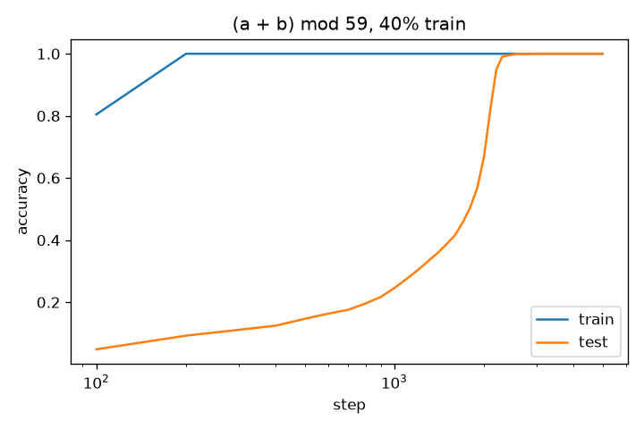
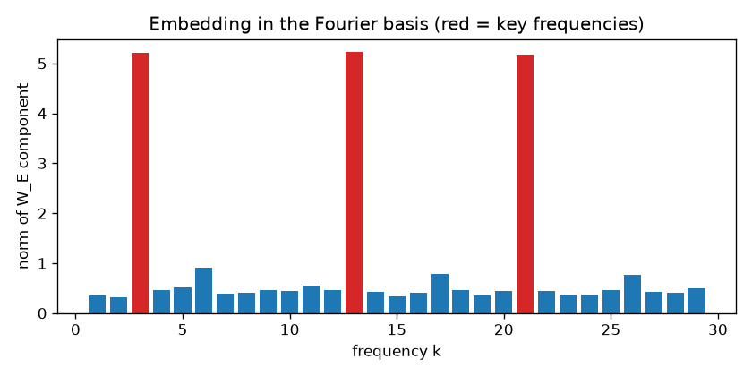
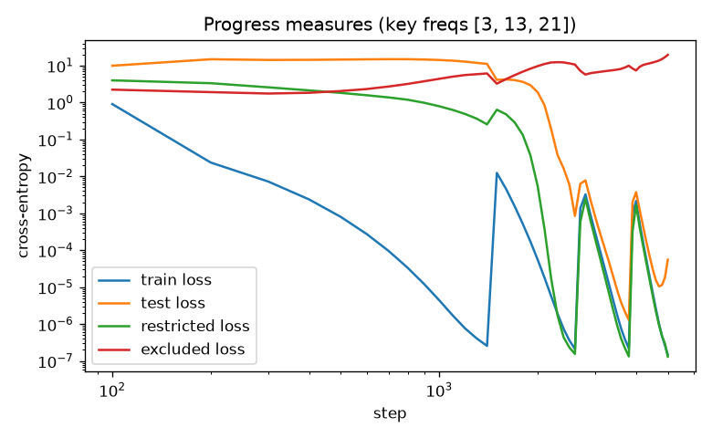

# Grokking progress measures

A CPU-sized reimplementation of [Progress measures for grokking via mechanistic interpretability](https://arxiv.org/abs/2301.05217) (Nanda et al., 2023). A one-layer transformer learns (a + b) mod p, memorizes first, then generalizes much later. The Fourier analysis shows the sparse set of frequencies it ends up using, and the restricted and excluded losses track the generalizing circuit forming before test accuracy moves.

## Setup

```
pip install -r requirements.txt
```

## Run

```
python grokking.py           # p=59, 5000 steps, a few minutes on CPU
python grokking.py --quick   # 500 steps, smoke test
```

It writes `accuracy.png`, `fourier_embed.png` and `progress_measures.png`.

Restricted loss keeps only the cos(w(a+b)) and sin(w(a+b)) components of the logits for the key frequencies w and is evaluated on all pairs. Excluded loss removes those components and is evaluated on the training set. Key frequencies are the ones carrying more than 3x the average energy in the Fourier-transformed embedding.

## Test

```
python -m pytest -q
```

## Results

Changes from the paper, made so it runs on CPU: p=59 instead of 113, a smaller model (d=64, 4 heads, MLP 256, no LayerNorm), 40% of pairs for training, and full-batch AdamW with lr 3e-3 and weight decay 1.0. With a 30% split at p=53, none of my runs grokked within 6000-8000 steps.

- Train accuracy reaches 99% at step 200 and test accuracy at step 2300.
- The embedding ends up concentrated on frequencies 3, 13 and 21, which hold 93% of its energy.
- Excluded loss climbs from about 2 to 6 between steps 300 and 1300, while test loss stays flat near 14. At the end, restricted loss (1.3e-7) is lower than the full model's test loss (5.6e-5), and excluded loss is 19.5 (a uniform guess scores 4.08).



